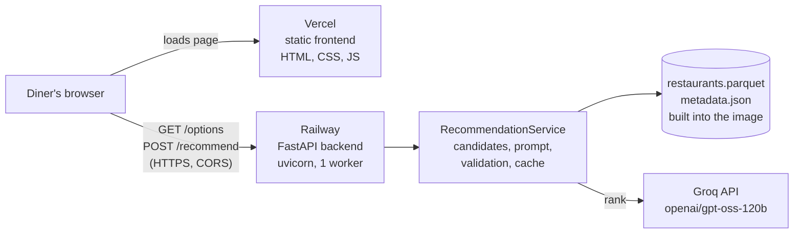

# Deployment Plan: Backend on Railway, Frontend on Vercel

This plan hosts BLB (Banga-Luru Bytes) with the backend on [Railway](https://railway.com) and the frontend on [Vercel](https://vercel.com). It replaces the platform choice in Phase 7 of the [implementation plan](implementation-plan.md#phase-7-deployment-optional), which suggested Streamlit Community Cloud, and keeps that phase's checks.

## How to Use This Plan

- Work through the phases in order. Each has tasks, tests and exit criteria, like the implementation plan.
- **Phase 0 must be finished before anything is made public.** It holds one blocker: the dataset licence.
- Tick the boxes as you go, and record any decision that changes in [Decisions](#decisions).

> **Status (2026-11-13): deployed and working end to end.**
>
> | Part | Address | Where it's managed |
> | --- | --- | --- |
> | Frontend | https://blb-frontend.vercel.app | Vercel project `blb-frontend`, Root Directory `frontend`, deploys from `main` on GitHub |
> | API | https://blb-benga-luru-bytes-production-f4839515.up.railway.app | Railway project `fearless-dedication`, service `BLB-Benga-luru-Bytes` |
>
> A search from the Vercel page returns AI-ranked results. **Still open:** the dataset licence, while the GitHub repository and both sites are public (Phase 0); cost limits, monitoring, the rate-limit burst test and rollback practice (Phase 5). Railway's `railway.json` format stops working on 2026-12-01, so run `railway config migrate` before then. The service also has a second, unused address, `blb-benga-luru-bytes-production.up.railway.app`, which can be removed.
>
> **Phase 6 of the implementation plan (evaluation) is only partly done.** Its free preparation is complete, but the paid pilot, the judge, the full run and tuning were deferred so deployment could start. Tuning may still change the model or effort settings deployed here.

## Summary

**Today the app is one Streamlit program.** `app.py` draws the page and calls the search code in `src/recommender/` directly, in the same process. There is no separate backend or frontend yet.

**Streamlit can't simply be moved to Vercel.** A Streamlit app is a long-running server that keeps a live WebSocket connection open to each browser, and keeps its sessions and result cache in that process's memory. Vercel runs short-lived functions. Its WebSocket support for functions is in beta and caps how long a function can run, so a Streamlit session would be cut off. Vercel is built for static sites and frontend frameworks.

**So deploying this way means splitting the app in two:**

| Part | Where | What it is | Status |
| --- | --- | --- | --- |
| Backend | Railway | A small HTTP API (FastAPI) around the existing `RecommendationService` | To build. The search, LLM ranking, validation, cache and logging are reused unchanged. |
| Frontend | Vercel | A static web page that calls the API and draws the results in the dark theme | To build, starting from `design/code.html` |
| Streamlit app | Your computer | `app.py`, as today | Kept for local use. It shares the same service code. |

The split is possible because `service.py` has no Streamlit imports by design ("so other clients can reuse it"). The API is a thin layer over it.

> **The simpler alternative:** If the goal is only to get BLB online, the whole Streamlit app can run on Railway as it is, with no API or new frontend. That's Phases 0 and 2 only, with a different start command. See [Decisions](#decisions). The rest of this plan assumes the split you asked for.

## Architecture



- The browser loads the page from Vercel, then calls the Railway API directly. The API allows only the Vercel site's origins (CORS).
- The Groq key exists only on Railway. The frontend never sees it.
- One uvicorn worker, so every request shares one result cache and one view of Groq's per-minute token limit.

## Phase 0: Decisions and Prerequisites

**Goal:** Clear the blockers and set up the accounts before writing deployment code.

### Tasks

- [ ] **Resolve the dataset licence.** `ManikaSaini/zomato-restaurant-recommendation` states no licence, and the project's own rules say not to host publicly or publish the data until this is settled ([edge case DEP-01](edge-cases.md#phase-7-deployment), [architecture section 13](architecture.md#13-open-decisions)). Until it is, keep the deployment private: don't share the URL publicly, and use the platforms' access protection where available.
- [ ] **Put the code in a private GitHub repository.** Both Railway and Vercel deploy from GitHub. Keep it private while the licence is open. `.gitignore` already keeps out `data/`, `.env` and `traces/`. *The code is at `fxdarshan/BLB-Benga-luru-Bytes`, but that repository is currently **public**.*
- [x] **Create the accounts:** Railway (the Hobby plan is $5 a month plus usage) and Vercel (the Hobby plan suits a personal, non-commercial project; check its terms if this becomes commercial).
- [ ] **Check Groq's limits against the expected traffic.** On the free plan the limit is 8,000 tokens a minute. A search now uses about 2,600 input and up to 1,000 output tokens, so only **2 or 3 new searches a minute fit across all users.** Cached repeats are free. Beyond that, Groq returns rate-limit errors and the app falls back to score-ranked results without AI text. Decide whether that's acceptable, or move to a paid Groq tier, and set a spend limit in the Groq console either way.
- [ ] Agree the decisions in [Decisions](#decisions), especially the frontend stack and how the data reaches Railway.

### Exit criteria

- [ ] The licence is resolved, or the deployment will stay private until it is
- [ ] A private GitHub repository holds the code, with no `.env` or `data/` in its history
- [ ] Railway and Vercel accounts exist, and the Groq plan and spend limit are chosen

## Phase 1: Backend API

**Goal:** Serve searches over HTTP, reusing the existing service, while the Streamlit app keeps working.

### Tasks

- [x] Add `fastapi` and `uvicorn[standard]` to the dependencies. Move `streamlit` to a `ui` dependency group, and `datasets`, `pandas` and `ftfy` to an `ingest` group, so the server image installs none of them. `[tool.uv] default-groups` installs every group locally, so existing commands are unchanged, and the image leaves them out with `uv sync --no-default-groups`.
- [x] Write `src/recommender/api.py`, a FastAPI app that loads the settings, repository and one shared `RecommendationService` at start-up, exactly as `app.py` does.
- [x] Add the endpoints in [API contract](#api-contract): `GET /health`, `GET /options` and `POST /recommend`.
- [x] **Return display-ready facts.** Build each result from the dataset record using the existing helpers in `display.py`, such as `format_rating`, `format_cost`, `format_cuisines` and `matched_dishes`. The frontend then draws strings and never re-implements formatting rules. The LLM still supplies only the explanation, unconfirmed preferences, the summary and the chosen review number, as today.
- [x] Validate requests with the existing `Preferences` model, which already limits the free text to 300 characters and the rating to 0–5. Return `422` for an unknown area or cuisine (`InvalidPreferencesError`).
- [x] Return `503` with a plain message if the data files are missing or damaged (`DataUnavailableError`), and make `/health` fail too, so Railway never sends traffic to a broken deployment.
- [x] **Allow only the frontend's origins (CORS).** Read them from `ALLOWED_ORIGINS`: the production domain. `ALLOWED_ORIGIN_REGEX` optionally adds a pattern for this project's Vercel preview URLs.
- [x] **Limit searches per client.** Add a per-IP limit on `POST /recommend`, such as 10 a minute, read from `RATE_LIMIT_PER_MINUTE`, returning `429` with a `Retry-After` header. Behind Railway's proxy every request comes from the proxy, so `TRUSTED_PROXY_HOPS=1` reads the diner's address from the entry the proxy added to `X-Forwarded-For`; entries before it come from the client and could be faked. This protects the Groq budget ([implementation plan, Phase 7](implementation-plan.md#phase-7-deployment-optional): "Add a per-session search limit").
- [x] Keep the one-line search log on standard output, where Railway collects it. It already holds no free text or keys.
- [x] Never return internal details. `failure_reason`, stack traces and raw LLM output stay in the logs.

### Tests

- [x] Endpoint tests with FastAPI's `TestClient` and the existing `FakeRanker` and small data files from `tests/`, so no test calls Groq
- [x] `/options` returns the areas, cuisines and dishes in menu order, and the budget labels
- [x] `/recommend` returns the facts, explanation and chosen review; an LLM failure returns score-ranked results with the notice
- [x] `422` for an unknown area, too-long free text or a rating out of range; `429` after the limit; `503` when the data is missing
- [x] A request from an origin not in `ALLOWED_ORIGINS` gets no CORS headers
- [x] The existing tests still pass, so the Streamlit app is unaffected: 474 in all, with `tests/test_api.py`

### Exit criteria

- [x] `uv run uvicorn --factory recommender.api:create_app --port 8000` serves a full search locally. `--factory` builds the app at start-up, so importing the module reads no settings. Checked with only the server's dependencies installed (`uv run --isolated --no-default-groups`).
- [x] All tests and lint pass

## Phase 2: Deploy the Backend to Railway

**Goal:** The API runs on Railway at an HTTPS address.

### How the data reaches Railway

`data/` is ignored by git, so Railway doesn't get it from the repository. **Build it inside the image** by running the existing ingestion during the Docker build:

- The dataset revision is pinned (`DATASET_REVISION` in `ingest.py`), so every build produces the same data, with the same `build_id`.
- No data goes into git, which matters while the licence is open.
- The data is about 5.5 MB once built and 12,449 restaurants in memory, so any Railway instance size is enough.
- The cost is a slower build: the raw dataset is a 574 MB download from Hugging Face, and processing it needs more memory than serving does. A build fails if Hugging Face is down. Railway keeps the previous deployment running when a build fails.
- **Use a two-stage build.** The first stage installs the `ingest` group and builds `data/`. The second stage installs only the server's dependencies and copies in the finished `data/`, so the 574 MB raw download and the `datasets` package never reach the running image.
- Docker caches the ingestion layer until `src/` changes, so most code changes still re-run it. That's acceptable at first. If builds get slow, move ingestion before `COPY src/` by copying only the files it needs, or switch to the volume below.

The fallback, if builds become too slow, is a Railway volume mounted at `/app/data` with `DATA_DIR` pointing to it, filled once by running the ingestion on the service.

### Tasks

- [x] Write a two-stage `Dockerfile` based on a Python 3.11 image with uv (the project's `.python-version` is 3.11). It also runs as an unprivileged user:
  1. **Data stage:** copy `pyproject.toml`, `uv.lock`, `Doc/problemStatement.md` and `src/`, run `uv sync --locked --no-dev --group ingest`, then run the ingestion to build `data/`
  2. **Server stage:** copy the same files, run `uv sync --locked --no-dev`, and copy `data/` from the data stage
  3. Start with `uvicorn --factory recommender.api:create_app --host 0.0.0.0 --port $PORT --workers 1`. Railway sets `PORT`, and the app must listen on it.
- [x] **Copy `Doc/problemStatement.md` into both stages.** `pyproject.toml` names it as the package `readme`, and hatchling fails to install the project without it.
- [x] Write a `.dockerignore` that leaves out `.env`, `.venv/`, `data/`, `traces/`, `tests/`, `graft/`, `frontend/`, `.git/` and everything in `Doc/` except `problemStatement.md`, so no secret or local file enters the image
- [x] Add `railway.json` setting the Dockerfile builder, `healthcheckPath` to `/health`, a restart policy for crashes, and watch patterns so that frontend-only commits don't rebuild the backend. Railway then waits for `/health` to return 200 before moving traffic to a new deployment.
- [x] Create the Railway project from the GitHub repository and set the variables in [Environment variables](#environment-variables), including `TRUSTED_PROXY_HOPS=1`. Put `GROQ_API_KEY` only in Railway's variables, never in a file.
- [x] Generate the Railway domain (`*.up.railway.app`), or attach a custom one such as `api.<your-domain>`
- [x] Set `ALLOWED_ORIGINS` once the Vercel address is known in Phase 4

### Tests

- [x] `curl https://<railway-domain>/health` returns 200 with `"ai_ranking": true`
- [x] A `POST /recommend` from your computer returns AI-ranked results, and its search line appears in Railway's logs
- [x] The build log and runtime logs show no API key
- [ ] Redeploying with a deliberately broken start leaves the previous deployment serving

### Exit criteria

- [x] The API completes a full AI-ranked search at its Railway address
- [ ] The health check gates deployments

## Phase 3: Frontend

**Goal:** A web page that matches the BLB dark design and works against the API.

### Tasks

- [x] Create `frontend/` as a small static site built with [Vite](https://vite.dev), using plain HTML, CSS and JavaScript. Start from `blb_dark_dining_finder/code.html` (the same as `design/code.html`) and its styles, which are already a complete static version of the page.
- [x] Read the API address from `VITE_API_BASE_URL` at build time, so the same code serves local, preview and production.
- [x] **Form:** load the areas, cuisines, dishes and budget labels from `GET /options`. Rebuild the controls the Streamlit app has: the area list, the 2×2 budget grid, cuisine and dish tags, the rating slider showing "★ 3.5", the unrated checkbox, and the "Anything else?" box limited to 300 characters.
- [x] **Results:** draw the search chips, notices, AI summary and cards from `POST /recommend`, including "Liked for", "Why this fits", "A customer said" and "Could not confirm", plus the empty state and the footnote about the data snapshot.
- [x] **Escape everything.** Set dataset, review and LLM text with `textContent`, never `innerHTML`. Today `display.py` escapes it on the server; in the frontend this rule replaces that.
- [x] Port the result animation: old results glide out while a search runs, then new ones rise in 90 ms apart, with motion turned off for "reduce motion". Show the loading message next to the button, as now, so the results never jump.
- [x] Show the "AI ranking on/off" pill from `GET /health`.
- [x] **Handle every failure plainly:** the API being unreachable, `429` ("Too many searches. Try again in a minute."), `422`, `503`, and a request that takes longer than 60 seconds.
- [x] Keep it accessible: real labels and buttons, visible focus, at least 44 px touch targets, and one column at phone width with no sideways scrolling.

### Tests

- [x] The page works against the local API, `npm run dev` with `VITE_API_BASE_URL=http://localhost:8000`. Checked with AI ranking off, to make no paid call: form options, tags, budget, a full search, chips, notices and cards.
- [x] Text containing `<script>` displays as text (checked with the free-text chip)
- [ ] Each failure above shows its message, and the form stays usable. The API being unreachable was checked in the browser; `429`, `422`, `503` and the timeout are mapped in `frontend/src/api.js` but not yet seen in a browser.
- [ ] Phone (375 px) and desktop (1440 px) layouts match the design. At 375 px there is no sideways scrolling and the form has 16 px margins; a visual comparison with screenshots is still to do.

### Exit criteria

- [x] `npm run build` produces `frontend/dist/`, and the page completes a full search against the local API

## Phase 4: Deploy the Frontend to Vercel

**Goal:** The page is live on Vercel and talks to the Railway API.

### Tasks

- [x] Import the GitHub repository into Vercel with **Root Directory** set to `frontend/`. Vercel detects Vite, with build command `npm run build` and output directory `dist`. Turn on skipping deployments when nothing in the root directory changed, so backend-only commits don't redeploy the frontend.
- [x] Add `frontend/vercel.json` with security headers, including a Content Security Policy whose `connect-src` allows `https://*.up.railway.app`. **If the API gets a custom domain, change `connect-src` to it**, or the browser will block every call.
- [x] Set `VITE_API_BASE_URL` to the Railway address for Production. For Preview, point it at the same API or at a separate Railway environment.
- [x] Add the Vercel production domain, and the preview pattern if wanted, to `ALLOWED_ORIGINS` on Railway, then redeploy the backend. *Only the production domains are allowed so far; preview URLs would need `ALLOWED_ORIGIN_REGEX`.*
- [ ] Optionally attach a custom domain, such as `blb.<your-domain>` for the frontend and `api.<your-domain>` for the backend.
- [ ] Keep access restricted while the licence is open, for example with Vercel's deployment protection.

### Tests

- [x] A full search from the Vercel address returns AI-ranked results
- [x] The browser console shows no CORS errors
- [x] A page opened from an origin not in `ALLOWED_ORIGINS` can't call the API (its preflight gets `400` with no CORS headers)

### Exit criteria

- [x] The hosted page completes a full search, end to end

## Phase 5: Hardening and Launch

**Goal:** The deployment is safe to leave running and easy to recover.

### Tasks

- [ ] **Costs:** set the Groq spend limit and Railway's usage limit, and check both dashboards after the first day
- [ ] **Monitoring:** use Railway's logs and metrics for errors, latency and memory, and add a free uptime check on `/health`
- [ ] **Rate limit:** confirm it holds against a burst of searches from one client, and check in Railway's logs that `TRUSTED_PROXY_HOPS=1` picks out the diner's address rather than the proxy's
- [ ] **Secrets:** search the repository, build logs, runtime logs and the built frontend for the API key, and confirm none appears
- [x] **README:** write `README.md` covering local setup, ingestion, running the API, Streamlit app and frontend, tests, and both deployments
- [ ] **Rollback:** practise it once on each platform: Railway can redeploy an earlier deployment, and Vercel can promote an earlier one to production

### Exit criteria

These include the exit criteria of the implementation plan's Phase 7.

- [x] The hosted app completes a full search
- [ ] No secret appears in the repository, logs or UI
- [ ] The search limit works when exceeded
- [ ] Someone else can follow the README from a fresh checkout
- [ ] Rollback has been tried on both platforms

## Phase 6: Experience Improvements

**Goal:** Make the hosted page quicker to use, especially on a phone, and start collecting feedback. Added on 2026-11-14, after launch.

### Tasks

- [x] **Phone layout:** after a search on a narrow screen, shrink the form to a one-line summary with "Edit search", and bring the results into view
- [x] **Card actions:** Directions (a Google Maps search link, no key), Share (Web Share, or copy a link), Save, and More like this (same main cuisine and price band, same area)
- [x] **Example searches** on the empty page, checked against `/options` so none can be invalid
- [x] **Loading:** placeholder cards and a step line ("Finding places…", "Ranking with AI…") instead of a lone spinner
- [x] **Shareable searches:** keep each search in the page address; the Back button returns to the previous search
- [x] **Remember the last search** in the browser's local storage
- [x] **Refine buttons:** Pocket friendly, a higher rating, Include new places, Clear filters
- [x] **Explain the AI-busy fallback:** `ai_busy` on `/recommend`, and a notice with Try again
- [x] **Shortlist** with a side-by-side comparison, kept in local storage
- [x] **Search in your own words:** `frontend/src/parse.js`, matched in the browser against the real lists, so no LLM call
- [x] **Feedback:** 👍 / 👎 per explanation, through `POST /feedback`
- [x] **Look:** "Top pick" on the first result, ratings coloured by band, cuisine icons
- [x] **Icons:** one set of rounded line icons in the accent colour across the form, refine buttons and cards; ₹ markers on budgets; food emoji on example searches
- [x] **Light theme:** follows the device's setting, with a sun/moon toggle remembered in local storage. `public/theme.js` applies a saved choice before the page draws, since the CSP allows no inline scripts. Every colour is a token, so the light palette is one block in `style.css`; text contrast is at least 5:1
- [x] **Illustrations:** `frontend/src/illustrations.js` draws the welcome, no-matches, AI-busy and error states as inline line art coloured by the theme. No photos: the dataset has none, and stock photos would misrepresent the restaurants
- [x] **Depth and motion:** header and top-pick glow, card lift, budget ring, menu and dialog slide-ins, button presses, a heart pop, and view-transition cross-fades, all off under reduced motion
- [x] **Home:** the BLB logo and name link home and reset the search: form defaults, own-words box, page address and remembered search cleared, a running search ignored, and the welcome screen shown. The shortlist and theme stay
- [x] **Wording:** the refine button says "Pocket friendly" rather than "Cheaper", which can suggest low quality
- [x] **Warm cache (off by default):** `WARM_CACHE_AREAS` keeps chosen areas' default searches cached
- [x] **Usage counts:** `GET /stats`
- [x] Dropdowns for area, cuisine and dish that open on click and grow the item under the cursor

### Not done, and why

- **"Include nearby areas":** each Zomato area listing already includes restaurants from nearby areas (marked "Near …"), so a separate option would change little.
- **Turning the cache warmer on:** it costs about one Groq search per named area per hour, which competes with diners on the free plan. Decide on the Groq plan first.

### Tests

- [x] 7 new API tests: `ai_busy`, stats counting, feedback validation and its own limit, warm-cache settings and behaviour. All 481 tests pass.
- [x] In a browser against the local API: own-words search, URL update, loading placeholders, cards with every new part, Save, the shortlist, feedback reaching `/stats`, Refine, Back, opening a shared link, and the phone layout at 375 px with no sideways scrolling

## API Contract

All responses are JSON. Text fields are plain text; the frontend escapes them.

### `GET /health`

```json
{ "status": "ok", "build_id": "dfd89683d570c0f8", "ai_ranking": true }
```

Returns 503 if the data didn't load.

### `GET /options`

```json
{
  "areas": ["BTM", "Banashankari", "..."],
  "cuisines": ["North Indian", "Chinese", "..."],
  "dishes": ["Biryani", "..."],
  "budgets": [
    { "value": "any", "label": "Any budget", "name": "Any budget", "range": "No limit" },
    { "value": "low", "label": "Low (below ₹500 for two)", "name": "Low", "range": "Below ₹500" },
    { "value": "medium", "label": "Medium (₹500 to ₹1,500 for two)", "name": "Medium", "range": "₹500 to ₹1,500" },
    { "value": "high", "label": "High (above ₹1,500 for two)", "name": "High", "range": "Above ₹1,500" }
  ],
  "defaults": { "min_rating": 3.5, "max_additional_chars": 300 }
}
```

Cuisines and dishes come in menu order: the most popular first, then A to Z, as `menu_order` gives them today.

### `POST /recommend`

Request, using the fields of the existing `Preferences` model:

```json
{
  "area": "Indiranagar",
  "budget": "medium",
  "cuisines": [],
  "dishes": ["Biryani"],
  "min_rating": 3.5,
  "include_unrated": false,
  "additional": "good for a date night"
}
```

Response:

```json
{
  "search_summary": ["Indiranagar", "Medium (₹500 to ₹1,500 for two)", "Any cuisine", "Biryani", "Rated 3.5+"],
  "relaxations": ["..."],
  "notice": null,
  "ai_ranked": true,
  "summary": "All five picks are in Indiranagar...",
  "results": [
    {
      "rank": 1,
      "name": "Maravanthe",
      "rating": "★ 4.4 (711 votes)",
      "is_rated": true,
      "cuisines": "Mangalorean, Seafood",
      "place": "Indiranagar",
      "badges": ["₹1,000 for two", "Casual Dining"],
      "near": null,
      "liked_for": ["Mutton Biryani"],
      "explanation": "Maravanthe offers a coastal twist on biryani...",
      "review": "The food was awesome and a clean restaurant...",
      "unverified": []
    }
  ]
}
```

- `near` holds "Near Indiranagar" when the restaurant is outside the chosen area, and is otherwise `null`.
- `review` holds the customer's own text, cut to about two lines.
- An empty `results` list means nothing matched, even after loosening the limits.

- `ai_busy` is `true` when the AI was skipped only because the provider's per-minute limit was reached, so the page can suggest trying again in a minute. It is `false` otherwise, including for other AI failures.

Errors: `422` invalid request, `429` too many searches (with `Retry-After`), `503` data unavailable. Each has a plain `"detail"` message.

### `POST /feedback`

A thumbs up or down on one result's explanation, for the evaluation:

```json
{ "restaurant": "Jose's Mess", "rank": 1, "helpful": true, "ai_ranked": true }
```

Returns `204` with no body. Each piece is counted in `/stats` and written to the log as one `feedback {...}` line with no free text. Limited to 30 a minute per client, separately from searches.

### `GET /stats`

Counts since the server last started. They reset on each deploy, so read them before redeploying if you need them.

```json
{
  "since": "2026-11-14T09:00:00Z",
  "searches": 42, "ai_ranked": 37, "cache_hits": 9,
  "fallbacks": { "rate_limited": 5 },
  "top_areas": [{ "name": "BTM", "count": 12 }],
  "top_cuisines": [], "top_dishes": [{ "name": "Biryani", "count": 8 }],
  "budgets": { "any": 30, "low": 12 },
  "feedback": { "helpful": 6, "not_helpful": 1 }
}
```

## Environment Variables

### Railway (backend)

| Variable | Value | Notes |
| --- | --- | --- |
| `GROQ_API_KEY` | Your key | Secret. Only here. |
| `LLM_PROVIDER` | `groq` | Or `anthropic`, with `ANTHROPIC_API_KEY` |
| `LLM_MODEL` | Empty | Uses the provider's default, `openai/gpt-oss-120b` for Groq |
| `LLM_EFFORT` | `low` | Keeps reasoning short, which saves tokens |
| `LLM_TIMEOUT_SECONDS` | `45` | |
| `MAX_CANDIDATES` | `8` | |
| `MAX_RESULTS` | `5` | |
| `DATA_DIR` | `./data` | Change only if the data moves to a volume |
| `ALLOWED_ORIGINS` | `https://<vercel-domain>` | New. Comma-separated. |
| `ALLOWED_ORIGIN_REGEX` | Empty | New. Optional pattern, such as one for Vercel preview URLs |
| `RATE_LIMIT_PER_MINUTE` | `10` | New. Searches per client per minute. |
| `TRUSTED_PROXY_HOPS` | `1` | New. Proxies that add to `X-Forwarded-For`, so the limit sees each diner's address |
| `WARM_CACHE_AREAS` | Empty (off) | Optional. Comma-separated areas whose default search is kept cached. Each costs about one Groq search an hour, so on the free plan name only a few, such as `BTM,Indiranagar,Koramangala 5th Block`. |
| `WARM_CACHE_INTERVAL_SECONDS` | `60` | Optional. Wait between warm-up searches, leaving most of Groq's per-minute limit for diners. |
| `PORT` | Set by Railway | Don't set it yourself |

### Vercel (frontend)

| Variable | Value | Notes |
| --- | --- | --- |
| `VITE_API_BASE_URL` | `https://<railway-domain>` | Not secret: it is built into the page |

## Config Files

These are in the repository. Check them against the platforms' current docs before the first deploy.

| File | What it does |
| --- | --- |
| [`Dockerfile`](../Dockerfile) | Two stages: builds `data/` with the `ingest` group, then a server stage with only the API's dependencies, running as an unprivileged user. uv is pinned to 0.12.19, the local version. |
| [`.dockerignore`](../.dockerignore) | Keeps `.env`, `data/`, tests, tooling, the frontend and all of `Doc/` except `problemStatement.md` out of the build |
| [`railway.json`](../railway.json) | Dockerfile builder, `/health` check with a 120-second timeout, restart on failure, and watch patterns so frontend-only commits don't rebuild the API |
| [`frontend/vercel.json`](../frontend/vercel.json) | Vite build, security headers (CSP, `nosniff`, referrer and permissions policies), and long caching for hashed assets |
| [`.claude/launch.json`](../.claude/launch.json) | Local `blb-api` and `blb-frontend` servers |

## First Deploy, Step by Step

The two platforms need each other's addresses, so do the first deploy in this order:

1. Push the repository to private GitHub, with `api.py`, the Docker files and `railway.json` in it.
2. **Railway:** New Project, then Deploy from GitHub repo. Set the variables, leaving `ALLOWED_ORIGINS` empty for now. Generate a domain under Settings, then Networking.
3. Check `https://<railway-domain>/health` returns 200.
4. **Vercel:** Add New Project, import the repository, set Root Directory to `frontend/`, set `VITE_API_BASE_URL` to the Railway address, and deploy.
5. **Railway:** set `ALLOWED_ORIGINS` to the Vercel production address. Changing a variable triggers a redeploy.
6. Run a full search from the Vercel address, with the browser console open.

From then on, a push to `main` redeploys whichever side changed.

## New Files

All written.

| File | Purpose |
| --- | --- |
| `src/recommender/api.py` | FastAPI app over `RecommendationService` |
| `tests/test_api.py` | Endpoint tests |
| `Dockerfile`, `.dockerignore` | Railway image, with the data built in |
| `railway.json` | Builder, health check, restart policy and watch patterns |
| `frontend/` | Vite site: `index.html`, `src/main.js`, `src/api.js`, `src/style.css`, `package.json` |
| `frontend/vercel.json` | Security headers |
| `README.md` | Setup, running and deployment |

## Decisions

| Decision | Recommended | Alternative | Why |
| --- | --- | --- | --- |
| Architecture | Split: FastAPI on Railway, static frontend on Vercel | Run the whole Streamlit app on Railway | The split is what you asked for. The alternative is much less work, needs no new frontend, and can be done first while the split is built. |
| Frontend stack | Vite with plain HTML, CSS and JavaScript | Next.js or React | `design/code.html` is already plain HTML and CSS, and the page is one form and a list. A framework adds build weight without much gain. |
| Data on Railway | Build it during the Docker build | A Railway volume, or the data committed to a private repository | Reproducible, and keeps data out of git while the licence is open |
| Calling the API | Directly from the browser, with CORS | Vercel rewrites proxying `/api/*` to Railway | Direct calls keep each diner's IP visible to the rate limit. A proxy hides the API address but may show only Vercel's IPs. |
| Workers | One uvicorn worker | Several workers | One shared cache and one view of the Groq token limit. A single worker handles this traffic, since searches wait on Groq, not the CPU. |

## Risks

| Risk | Effect | Mitigation |
| --- | --- | --- |
| The dataset licence restricts use | Can't host publicly | Phase 0. Stay private until resolved. |
| Groq's free plan allows 8,000 tokens a minute | Only 2 or 3 new searches a minute get AI text | Cache, rate limit, the score-ranked fallback, or a paid Groq tier |
| Ingestion runs out of memory during the Railway build | The build fails | Check the build log for an out-of-memory kill. Then build `data/` once on a volume instead. |
| Hugging Face is down during a build | The build fails | Railway keeps the previous deployment. Switch to a volume if this recurs. |
| A wrong `ALLOWED_ORIGINS` value | The page can't reach the API | Check the browser console after each change of domain |
| Abuse of the public API | Groq spend, or the limit used up | Per-IP rate limit, Groq spend limit, Railway usage limit |
| The new frontend drifts from the Streamlit UI | Two UIs to maintain | Treat the web frontend as the main UI once launched, and keep Streamlit for local development only |

## Sources

Checked on 9 November 2026. Platform details change, so confirm them in each platform's docs when you deploy.

- [Railway: health checks](https://docs.railway.com/guides/healthchecks)
- [Railway: volumes](https://docs.railway.com/reference/volumes)
- [Railway: pricing plans](https://docs.railway.com/pricing/plans)
- [Vercel: do Vercel functions support WebSocket connections?](https://vercel.com/kb/guide/do-vercel-serverless-functions-support-websocket-connections)
- [Vercel: WebSockets for functions](https://vercel.com/docs/functions/websockets.graph.md)
