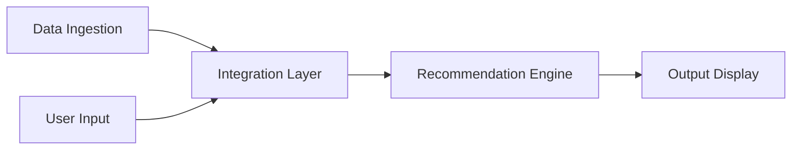

# Problem Statement: AI-Powered Restaurant Recommendation System

> Zomato use case. Source: [ProblemStatement.txt](ProblemStatement.txt)

## Overview

Build an AI-powered restaurant recommendation service inspired by Zomato. The system suggests restaurants based on user preferences by combining structured restaurant data with a Large Language Model (LLM).

## Objective

Design and implement an application that:

- Takes user preferences, such as location, budget, cuisine, and ratings
- Uses a real-world dataset of restaurants
- Leverages an LLM to generate personalized, human-like recommendations
- Displays clear and useful results to the user

## Dataset

| Item | Detail |
| --- | --- |
| Name | Zomato Restaurant Recommendation |
| Source | [ManikaSaini/zomato-restaurant-recommendation](https://huggingface.co/datasets/ManikaSaini/zomato-restaurant-recommendation) on Hugging Face |
| Fields to extract | Restaurant name, location, cuisine, cost, rating, etc. |

## System Workflow

### 1. Data Ingestion

- Load and preprocess the Zomato dataset from Hugging Face
- Extract relevant fields such as restaurant name, location, cuisine, cost, and rating

### 2. User Input

Collect the following user preferences:

| Preference | Examples |
| --- | --- |
| Location | Delhi, Bangalore |
| Budget | Low, medium, high |
| Cuisine | Italian, Chinese |
| Minimum rating | A rating threshold set by the user |
| Additional preferences | Family-friendly, quick service |

### 3. Integration Layer

- Filter and prepare relevant restaurant data based on user input
- Pass the structured results into an LLM prompt
- Design a prompt that helps the LLM reason about and rank the options

### 4. Recommendation Engine

Use the LLM to:

- Rank restaurants
- Provide explanations of why each recommendation fits
- Optionally summarize the choices

### 5. Output Display

Present the top recommendations in a user-friendly format. Each recommendation shows:

- Restaurant name
- Cuisine
- Rating
- Estimated cost
- AI-generated explanation
